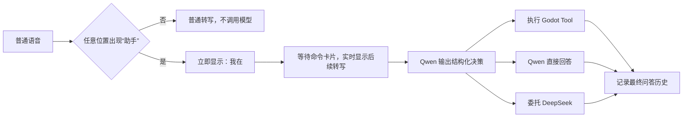

# 语音助手交互改造计划

## 一、现状与问题定位

### 1. Qwen 问答没有进入历史窗口

菜单中的助手历史窗口由 GodotSpace 的
`Assets/ARSpace/Scripts/LLMAssistantCanvas/LLMAssistantUIView.gd` 实现，数据来自
`LLMAssistantService` 中的 `_qa_history`。

当前 Qwen Router 在
`Assets/ARSpace/Scripts/AI/LocalAgent/assistant_command_router.gd`
中直接向 `VoiceChat` 发布结果，没有调用 `LLMAssistantService` 的历史记录逻辑。
因此，Qwen 的回答只能出现在实时语音窗口，不能进入菜单中的历史窗口。

### 2. 任务推进仍依赖模型自觉调用工具

虽然 Qwen 系统提示词已经要求“我完成这一步了，下一步该做什么”等表达调用
`next_task_step`，但当前实现仍允许模型绕过工具并直接生成文字回答。提示词只能提高
调用概率，不能保证工具一定被执行。

### 3. 现有唤醒逻辑只能识别句首

当前 Router 只处理最终转写，并要求文本以“助手”开头。它没有处理流式 partial
transcript，也没有“唤醒后等待用户继续说话”的交互状态。

## 二、目标交互



## 三、阶段一：统一历史记录

为 `LLMAssistantService` 增加公开接口，例如：

```gdscript
record_external_qa(request_id, question, answer, success, metadata)
```

实现规则：

- Qwen 直接回答、工具成功、工具失败和 DeepSeek 委托结果都进入历史。
- 使用 `request_id` 去重，每个请求只产生一条历史。
- “我在”“正在理解”“正在执行”等临时状态不进入历史。
- 记录 `provider`、`route`、`tool_name`、`speaker_peer_id` 和错误码。
- DeepSeek 委托由 Router 统一记录，避免 DeepSeek 和 Router 各写一次。
- 保留原有非 Qwen 问答的记录逻辑。

验收时依次完成一次打开相册、任务翻页、普通问答和失败请求，历史窗口应出现四条
记录且没有重复。

## 四、阶段二：建立强约束的工具路由

不再单纯依赖 Qwen-Agent 是否主动生成函数调用。先让 Qwen 输出严格的结构化决策：

```json
{
  "route": "tool",
  "tool": "next_task_step",
  "arguments": {}
}
```

`route` 只允许以下值：

- `tool`
- `direct_answer`
- `delegate_deepseek`
- `clarify`

实现原则：

- 工具名称只能从当前 UI 快照授权的工具中选择。
- Qwen 选择 `tool` 后，由 Gateway 确定性派发工具，不能退化成文字说明。
- 无效 JSON 或非法工具最多重试一次，仍失败则返回明确错误。
- 工具最终反馈以 Godot 验证结果为准，模型不得自行宣称成功。
- 保留现有的 `expected_task_id`、`expected_page_index` 和 `operation_id`，防止重复推进。
- 不增加 `TaskGuideController`，继续复用现有薄 Adapter 和 `advance_if_index()`。

指导书打开时，以下表达必须选择 `next_task_step`：

- “助手，我完成这一步了，下一步该做什么”
- “助手，这一步做完了，继续”
- “助手，下一步该做什么”
- 上述语句常见的 ASR 无标点和同音变体

同时加入否定回归用例，例如“别翻页”和“如果我完成了以后怎么办”不得改变步骤。

## 五、阶段三：实现持续唤醒会话

在 Router 中按 `speaker_peer_id` 维护状态机：

```text
IDLE → LISTENING_COMMAND → PROCESSING → IDLE
```

行为定义：

- 在 partial 或 final 转写的任意位置识别“助手”。
- 识别后立即在等待卡片中显示“我在”，不等待 Qwen 推理。
- “助手”后面已有内容时，只截取其后的内容作为命令。
- 如果只说了“助手”，则等待下一段最终转写。
- 唤醒前的内容不发送给模型，作为隐私边界。
- 约 8 秒没有后续命令时自动退出等待状态。
- “取消”“算了”在等待状态下本地取消，不调用模型。
- 为 ASR 转写增加 `utterance_id`，避免持续增长的 partial transcript 重复唤醒。
- 不同 VR Client 的唤醒、命令和执行状态严格隔离。

可以将“助手”加入腾讯 ASR 热词，提高唤醒词识别稳定性。

## 六、阶段四：增加等待回答 UI

修改 GodotSpace 中的 `voice_chat_ui.gd` 和对应场景，增加独立的等待卡片，不再把
处理中状态作为普通聊天消息插入历史。

等待卡片需要支持以下状态：

- `我在，请说`
- `正在听：……`，实时显示 partial transcript
- `正在理解`
- `正在执行：切换任务步骤`
- 失败、超时和取消

任务完成后移除等待卡片，再把最终回答追加到对话区。这样可以保证处理中状态始终
位于用户话语下方，也不会污染问答历史。如果需要语音反馈，“我在”应使用本地短音频
或已有语音播放能力，不等待模型生成。

## 七、测试与验收

需要补充以下测试：

- Qwen 路由结构 Schema 和非法输出测试。
- 指定完成语句必须派发 `next_task_step` 的回归测试。
- 工具失败、最后一页、重复请求和过期页码测试。
- 唤醒词位于句首、句中和单独成句的测试。
- partial transcript 重复、等待超时、取消和多人隔离测试。
- Qwen、工具和 DeepSeek 三种结果的历史记录测试。
- 4090 Qwen 服务与本地 Godot 的真实端到端语音验收。

关键验收标准：

1. ASR 转写中出现“助手”后立即显示“我在”。
2. “我完成这一步了，下一步该做什么”使指导书恰好推进一页。
3. 最终问答只在历史窗口记录一次。
4. 非唤醒语音不会产生 Qwen 请求或助手等待状态。
5. 工具失败时不得显示操作成功。

## 八、实施顺序与分支

建议按以下提交顺序开发：

1. 恢复 Qwen 问答历史记录。
2. 增加 Qwen 结构化路由和确定性工具派发。
3. 增加分说话者唤醒状态机。
4. 增加等待回答 UI。
5. 补齐自动化测试和真实模型验收。

GodotSpace 修改只在 `feature/local-agent-voice-tools` 分支进行；模型 Gateway 修改继续
在 `feature/task-agent-mvp` 分支进行。预计总工作量约为 4～6 个开发日。
