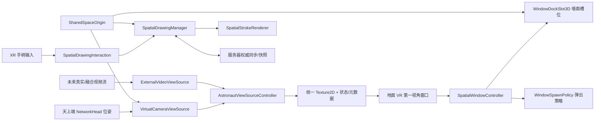

# SpaceProject 功能迁移与 GodotSpace 实施计划

> 文档状态：调研完成，等待进入实现阶段
>
> 调研分支：`codex/spaceproject-feature-plan`
>
> 调研日期：2026-07-23
>
> 本文档只描述设计与实施顺序，不包含任何工程代码修改。

## 1. 目标与范围

本计划以 Unity 工程 `F:\spaceproject-V2.0.2_NewPlayerModel\SpaceProject` 为交互参考，在 GodotSpace 中规划以下三项功能：

1. 在地面端 VR 环境中增加独立的“天上端第一视角”窗口。
   - 第一阶段使用天上端同步过来的头部位姿，在地面端本地重建一台虚拟相机并渲染画面。
   - 为未来的真实视频或虚实融合视频流保留可替换的视图源接口。
2. 迁移 Unity 天上端 VR 的空间窗口交互。
   - 支持窗口拖拽、墙面吸附、吸附预览、槽位占用与释放。
   - 支持从当前窗口旁边弹出新窗口，并提供无父窗口时的可靠回退位置。
3. 增加空间自由绘制。
   - 保留现有空间标定和虚拟标注功能。
   - 新建独立的空间笔画数据、渲染、输入和网络同步模块。

已确认的产品约束：

- 第一视角窗口只在 `ground_vr` 可见，并且其打开状态和空间变换不参与同步。
- 除第一视角窗口外，其他窗口、空间内容和业务状态在 `pc_ground`、`ground_vr`、唯一 `sky` 三端完全同步。
- `ground_vr` 与 `sky` 都可以绘制；`pc_ground` 接收并显示同步后的笔画，但不提供绘制输入。
- 绘制发布流程按 Unity 版本实现，保留显式“同步标记”和取消同步。
- 墙面吸附只使用编辑器中明确布置的槽位；实现阶段先在场景中加入可调整的槽位节点，再由场景制作人员手动贴合墙体。

本轮不包含：

- 真实相机、WebRTC、PICO 视频流或虚实融合算法的实际接入。
- 对 `PSA2/PAA1` 空间标定协议、`8787` 端口或 Depth Pro 流程的修改。
- 对第三方 `addons/` 的直接业务定制。
- Unity 代码逐行照搬；只迁移已经验证有价值的交互语义和数据流程。

## 2. 调研结论

### 2.1 GodotSpace 已具备的基础

| 能力 | 当前实现 | 对本需求的价值 |
| --- | --- | --- |
| 运行角色 | `runtime_profile.gd` 已区分 `pc_ground`、`ground_vr`、`sky` 及桌面/XR 展示方式 | 可以只在地面 VR 创建第一视角窗口，并按角色选择天上端 |
| 角色注册 | `network_handler.gd` 保存服务器权威的 peer 角色快照，并发出 `peer_role_changed` | 可以处理天上端连接、换角色、断线和重连 |
| XR 位姿同步 | `player.gd` 同步头部和双手位姿，远端玩家保留 `NetworkHead` | 第一阶段无需传输视频帧，直接用天上端 `NetworkHead` 驱动地面端相机 |
| 现有第一视角预览 | `XR_Main.gd` 已有 `SubViewport` 相机，并跟随一个远端玩家的 `NetworkHead` | 证明“远端位姿 + 本地重渲染”路径可行 |
| 3D 窗口 | `voice_call_window_3d.tscn` 使用 XR Tools 的 `viewport_2d_in_3d.tscn` | 可复用 2D UI 显示、射线输入和窗口表面，不必重建整套 UI 投影 |
| 窗口拖拽 | 当前 XR Tools 脚本已有 Grip 拖拽、面向用户和窗口变换同步逻辑 | 可作为交互参考，但吸附应放在业务层，不能继续把逻辑堆进插件 |
| 新窗位置雏形 | `Global.gd` 保存上一个窗口位置并计算右侧偏移 | 说明项目已有迁移方向，但当前调用和单位语义不够完整，需统一为米制空间窗口策略 |
| 虚拟标注 | `VirtualAnnotationSystem.tscn` 具备服务器权威 CRUD、版本快照、晚加入恢复、角色校验和输入避让 | 空间绘制可复用架构模式，但必须保持独立数据类型和 RPC |
| 标定 | `SpatialCalibration` 已有独立收帧、预览、深度和确认点同步链路 | 新绘制模块无需侵入或复用标定协议 |

需要修正的现状：`XR_Main.gd` 当前按远端 peer ID 排序选择第一位远端玩家，不能保证选中 `sky`。在同时存在地面 VR 与天上端时，第一视角窗口必须按 `NetworkHandler` 中的角色选择来源。

另外，当前预览是“依据远端头部位姿在本机重建的单目虚拟画面”，并不是天上端头显的逐像素画面。因此它不会包含：

- 天上端设备的真实透视画面；
- 只存在于天上端本地的叠加层；
- 双眼畸变、设备合成后的最终 framebuffer。

这与第一阶段“先显示虚拟相机画面”的目标一致，也正是后续必须保留外部视频源接口的原因。

### 2.2 Unity SpaceProject 的可迁移设计

#### 第一视角/视频窗口

- `MultiReceiverMediaStreamSender.cs` 用 `Camera.CaptureStreamTrack(...)` 把虚拟相机作为视频源。
- `MultiReceiverliediaStreamReceiver.cs` 在 `OnTrack` 中把视频纹理交给 `RawImage`。
- `RTCCanvas.prefab` 和 `RTCUIView.cs` 将接收画面放进独立可拖拽窗口。

应迁移的是“窗口只消费纹理，不关心纹理由虚拟相机还是网络解码器产生”的边界，而不是当前 Unity WebRTC 信令实现。

#### 窗口弹出与墙体吸附

- `WindowController.cs` 在 `OnEnable()` 时把窗口放到 `ParentWindowPivot`。
- 主菜单等窗口提供 `ChildWindowPivot`/`ChildWindowPivot_L`，子窗口通常是预实例化对象，通过 `SetActive(true)` 再定位，并非每次动态 Instantiate。
- 拖拽时向前检测 `AdsorbCollider`；进入槽位显示预览，离开隐藏预览。
- `AdsorbCollider.cs` 的有效实现是文件后半部分的简单状态机：
  - 空槽位才显示预览；
  - Drop 后占用槽位，并将窗口的位置、旋转和比例过渡到预览 Transform；
  - 再次拖动时释放槽位并恢复可调状态；
  - 一个槽位同一时间只允许一个窗口。
- `WindowManager.cs` 统一管理窗口焦点、层级和吸附层。

不应迁移该文件中已经注释掉的旧版复杂吸附实现。

#### 空间绘制

- `MarkerItem.cs` 使用右手下的 Marker Tip 作为空间采样点。
- 按住扳机创建 `LineRenderer`，移动期间追加 `Vector3` 点。
- 支持颜色、线宽、笔尖前后距离、撤销、清除和显式“同步”。
- `LineRenderListData.cs` 的笔画核心数据是：笔画编号、颜色编号、线宽和点数组。
- `LineRenderListManager.cs`/`NetLineRenderer.cs` 用 Create/Delete 命令传递整条笔画。

需要保留这套用户体验，但不照搬以下技术限制：

- 每帧按精确位置变化采样，没有最小距离和简化；
- 点数、总笔画和消息大小缺少明确上限；
- 整条笔画一次性发送，不适合长笔画；
- 缺少服务器权威校验、晚加入快照、重连恢复和严格所有权；
- Unity `LineRenderer` 不能直接对应 Godot 节点；当前转换得到的 `DrawLine.prefab.tscn` 只是空占位，不能复用为渲染实现。

## 3. 总体架构

三项功能保持模块独立，只共享角色、共享空间原点和输入仲裁：



建议将三个业务模块分别放在以下新目录，避免继续扩张 `XR_Main.gd` 或 `NetworkHandler`：

```text
res://Assets/ARSpace/Scripts/AstronautView/
res://Assets/ARSpace/Scripts/SpatialWindows/
res://Assets/ARSpace/Scripts/SpatialDrawing/
```

场景分别放入：

```text
res://Assets/ARSpace/Scenes/AstronautView/
res://Assets/ARSpace/Scenes/SpatialWindows/
res://Assets/ARSpace/Scenes/SpatialDrawing/
```

## 4. 功能一：天上端第一视角独立窗口

### 4.1 第一阶段数据路径

1. `NetworkHandler` 提供唯一 sky peer 的稳定查询接口，例如 `get_sky_peer_id()`。
   - 服务器在角色注册阶段维护唯一的 `_sky_peer_id`。
   - 第一个有效 sky 端占用该角色槽位。
   - 第二个 sky 端的角色请求以 `sky_slot_occupied` 拒绝，不进入协作空间。
2. 地面 VR 本地的视图控制器监听：
   - peer 连接/断开；
   - `peer_role_changed`；
   - 玩家节点生成/销毁。
3. 选择规则：
   - `get_sky_peer_id()` 返回有效 peer 时直接使用该唯一来源；
   - sky 断线后清空角色槽位，窗口进入等待状态；
   - 新 sky 端成功注册后恢复画面；
   - 无可用来源时窗口保留，显示“等待天上端连接”状态。
4. `VirtualCameraViewSource` 在本地 `SubViewport` 中创建单目 `Camera3D`，每帧跟随该玩家的 `NetworkHead`。
5. 相机与主场景共享 `World3D`，输出 `ViewportTexture`。
6. 独立窗口只显示来源控制器输出的纹理、状态和来源名称。

无需新增视频帧 RPC；网络上仍然只传现有的位姿数据。

### 4.2 视图源接口

GDScript 没有传统 interface，建议定义抽象基类 `AstronautViewSource`，至少提供以下契约：

- `start(source_peer_id: int) -> void`
- `stop() -> void`
- `get_texture() -> Texture2D`
- `get_status() -> int`
- `get_metadata() -> Dictionary`
- `texture_changed(texture: Texture2D)` 信号
- `status_changed(status: int, message: String)` 信号
- `metadata_changed(metadata: Dictionary)` 信号

状态至少包含：

```text
IDLE / CONNECTING / LIVE / STALLED / ERROR
```

元数据应保留：

- 来源类型和 peer ID；
- 分辨率、宽高比和帧时间；
- 虚拟相机 FOV，或真实流的内参/外参版本；
- 色彩空间、旋转方向；
- 未来虚实融合所需的时间戳和标定版本。

第一阶段实现 `VirtualCameraViewSource`。未来新增 `ExternalVideoViewSource` 时，只需把解码后的 `Texture2D` 和元数据交给相同控制器，窗口、吸附和弹出逻辑都不需要改。

未来外部视频必须使用独立传输协议和生命周期，不能复用空间标定的 `PSA2/PAA1` 帧、`8787` 端口或 ACK。

### 4.3 窗口场景

计划新增：

```text
AstronautViewWindow3D.tscn
AstronautViewPanel.tscn
astronaut_view_window_controller.gd
astronaut_view_source.gd
virtual_camera_view_source.gd
```

窗口建议基于 XR Tools `viewport_2d_in_3d.tscn` 的能力构建，但在外层由 `SpatialWindowController` 统一管理移动。窗口内容包含：

- 16:9 画面区域；
- 来源名称；
- 等待、卡顿和错误状态；
- 关闭和恢复位置按钮；
- 可选的帧率/延迟调试信息。

渲染相机需要使用明确的可见层，避免拍到本地第一视角窗口自身、XR 控制器调试节点和只应在地面端显示的 UI。

### 4.4 生命周期与显示条件

- 只在 `runtime_profile.is_ground()` 且 `runtime_profile.uses_xr()` 时创建或显示。
- `pc_ground` 桌面端保留现有右下角预览，本阶段不强制替换。
- `sky` 端不创建自己的监视窗口。
- 场景切换、断线和视图源切换时先停旧来源，再释放 `SubViewport`/纹理引用。
- 地面 VR 既可能是服务器，也可能是客户端，不能把“地面 VR”等同于 `multiplayer.is_server()`。

### 4.5 验收标准

- 地面 VR 与 sky 连接后，窗口稳定显示 sky 的虚拟第一视角。
- 同时存在 `ground_vr` 和 `sky` 时不会误选地面 VR 自身或 PC Server。
- 会话中只允许一个 sky 角色，第二个 sky 端会收到明确的角色槽位占用错误。
- sky 移动头部时画面跟随，重连后能恢复。
- 无 sky 时窗口不报错，状态明确。
- 替换为测试纹理源时无需改窗口代码，证明视图源边界有效。
- 窗口画面不会形成递归取景。

## 5. 功能二：空间窗口弹出与墙面吸附

### 5.1 业务层窗口状态机

新增 `SpatialWindowController`，统一维护：

```text
HIDDEN -> FLOATING -> DRAGGING -> SNAP_CANDIDATE -> SNAPPED
```

关键事件：

- `window_opened`
- `drag_started`
- `drag_updated`
- `snap_candidate_changed`
- `drag_finished`
- `snapped`
- `undocked`
- `window_closed`

不建议直接修改 `addons/godot-xr-tools`。具体做法是：

- 外层 `SpatialWindowController` 作为业务窗口根节点；
- 内层继续使用 XR Tools 的 Viewport 表面和指针映射；
- 关闭内层自带的 `allow_window_drag`；
- 外层监听指针事件和 Grip，移动整个窗口根节点；
- 吸附、权限、占用和最终变换只存在于业务层。

这样既能获得明确的拖拽开始/结束事件，也能避免新功能依赖插件私有变量或当前缺少发送者校验的通用窗口 RPC。

### 5.2 墙面槽位

第一阶段采用与 Unity 相同的“显式槽位”，不做任意墙面自动识别：

- `WindowDockSlot3D` 放置在允许吸附的位置；
- 每个槽位包含：
  - 稳定 `slot_id`；
  - 检测体；
  - 最终吸附 Transform；
  - 与窗口尺寸匹配的半透明预览；
  - 当前占用窗口 ID；
  - 可接受的窗口类别和尺寸范围。
- `WindowDockManager` 负责查询、占用、释放和重复 ID 检查。

实现阶段先在 `ARSpace.tscn` 中增加一组可工作的占位槽位，统一放在清晰命名的 `WindowDockSlots` 节点下。槽位的最终位置、旋转和尺寸全部以编辑器 Transform 为准，不在脚本中写死墙体坐标。每个槽位在编辑器中应显示边框/半透明预览和朝向标识，方便后续直接拖动并与实际墙体对齐。

拖拽行为：

1. 开始拖拽已吸附窗口时，立即释放原槽位并恢复浮动比例。
2. 拖拽中用窗口中心或控制器前向检测最近的有效槽位。
3. 空槽位显示预览；已占用槽位不能成为候选。
4. 候选变化时切换预览并提供一次轻量振动。
5. 在有效候选上松手，窗口平滑过渡到槽位位置、朝向和目标尺寸。
6. 在无候选处松手，保持浮动并继续面向用户。
7. 关闭、销毁、断线或切场景时必须释放槽位。

吸附检测使用独立 physics layer/mask，不能与虚拟标注表面、标定点、玩家碰撞或 UI 指针层混用。

### 5.3 新窗口弹出策略

保留 Unity 的父子锚点语义，但增加稳定回退：

1. 触发按钮所在窗口若提供 `ChildSpawnAnchor3D`，新窗口从该锚点弹出。
2. 没有显式锚点时，从最近一次获得焦点的窗口右侧按窗口实际米制宽度加间隔放置。
3. 若没有活动窗口，则放到用户头部前方约 1.2～1.8 米、视线略下方。
4. 检查与已有窗口及墙面的重叠，必要时左右交替或逐级下移。
5. 保留目标窗口自身比例，并让正面朝向当前用户。

第一阶段沿用 Unity 的“唯一窗口预实例化、打开/关闭复用”模型。只有明确出现同类型多实例需求时，再引入窗口工厂和实例 ID。

现有 `Global.gd` 的“最后点击窗口 + 固定右偏移”只作为参考，不继续扩展；弹出策略、单位换算、焦点和锚点应收敛到新的窗口管理器。

### 5.4 本地与共享边界

同步边界固定为：

- “天上端第一视角窗口”只在 `ground_vr` 实例化或显示。
- 第一视角窗口的打开/关闭、位置、旋转、比例和槽位占用属于地面 VR 本地状态，不发送到 `pc_ground` 或 `sky`。
- 除第一视角窗口外，其他窗口及空间内容的创建/显示、打开/关闭、位置、旋转、比例、吸附槽位占用和业务数据均在 `pc_ground`、`ground_vr`、`sky` 三端同步。
- 三端共享状态由服务器校验并广播；晚加入或重连端通过修订号快照恢复完整状态。
- 共享窗口变换需要校验窗口 ID、操作者角色、距离、比例和更新频率。

新窗口控制器可以保留 `LOCAL_GROUND_VR` 与 `SHARED` 两种内部作用域，但业务配置中只有第一视角窗口使用前者，其他窗口统一使用 `SHARED`。这样可以明确唯一例外，同时不直接复用当前 XR Tools 中校验不足的通用窗口变换 RPC。

### 5.5 验收标准

- 新窗口优先从父窗口旁边出现，首次打开也不会出现在原点或用户身后。
- 拖动到空槽位时有明确预览和振动，松手后位置、旋转、比例正确。
- 同一槽位不能同时吸附两个窗口。
- 从槽位拖走、关闭窗口、断线和切场景都会释放占用。
- 浮动和吸附状态下的点击、关闭、缩放不会与射线输入冲突。
- 第一视角窗口只在地面 VR 可见，本地移动不会影响其他 peer。
- 除第一视角窗口外，任一端对共享窗口执行的受支持操作都会在另外两端得到一致结果。

## 6. 功能三：空间自由绘制

### 6.1 与现有功能的边界

新增独立场景：

```text
SpatialDrawingSystem.tscn
├── SpatialDrawingManager
├── SpatialDrawingRenderer
└── SpatialDrawingInteraction
```

挂载在 `SharedSpaceOrigin` 下，与以下系统并列：

- `SpatialCalibration`：真实视频取点、深度和确认标定点；
- `VirtualAnnotationSystem`：依附模型表面的文字点标注；
- `SpatialDrawingSystem`：自由空间中的连续笔画。

明确不复用：

- 空间标定 TCP 收包器、magic、ACK、深度请求和确认点 RPC；
- 虚拟标注的 annotation ID、marker 节点或文字数据；
- Unity 转换出的空 `DrawLine.prefab.tscn`。

可复用的模式：

- `SharedSpaceOrigin` 坐标；
- `NetworkHandler` 角色信息；
- VirtualAnnotation 的服务器权威、修订号、快照、晚加入恢复和输入避让思路；
- 右手 `FunctionPointer`/拾取功能与 3D UI 的优先级判断。

### 6.2 笔画数据

每条已提交笔画使用稳定记录：

| 字段 | 含义 |
| --- | --- |
| `stroke_id` | 服务器分配的会话内唯一 ID |
| `creator_peer_id` | 创建者 |
| `revision` | 笔画/全局状态修订号 |
| `points` | 相对 `SharedSpaceOrigin` 的 `PackedVector3Array` |
| `color` | 规范化颜色值，不只保存调色板索引 |
| `width_m` | 米制线宽 |
| `created_at_msec` | 会话时间戳 |
| `completed` | 是否已经封笔 |

第一阶段建议集中配置并验证以下初始上限，后续由真实设备性能测试调整：

- 会话最多 256 条已提交笔画；
- 单笔最多 2048 个简化后点；
- 线宽限制在 0.002～0.05 米；
- 采样最小距离约 0.005 米，并设最大采样间隔，兼顾慢速绘制；
- 单个可靠消息不承载无界点数组，按固定点数分块；
- 拒绝 NaN、Infinity、超出共享空间合理边界的坐标；
- 限制每 peer 的提交频率、待提交字节和未完成笔画数。

### 6.3 本地绘制交互

参考 Unity Marker：

1. 打开“空间绘制”工具后，在右手控制器前方显示笔尖。
2. 按下扳机开始笔画，持续按住时按距离/时间阈值采样。
3. 松开扳机封笔；少于两个有效点的笔画丢弃或渲染为小圆点。
4. 摇杆前后调节笔尖距离，并限制在舒适范围。
5. 面板提供颜色、线宽、撤销上一笔、清除本地草稿、同步和退出。
6. 当射线命中更近的 3D UI、正在拖动窗口或抓取物体时，绘制输入必须让路。
7. 退出工具、断线、换场景时正确结束或丢弃未完成笔画。

发布流程按 Unity 原交互实现：

- 完成的笔画先进入本地待同步队列；
- “撤销”优先撤销尚未同步的最后一笔；
- 点击“同步标记”后批量提交，并显示成功/失败状态；
- 关闭或退出绘制工具时弹出“是否同步标记”，确认则提交待同步笔画，取消则清除尚未同步的本地笔画；
- “清空本地”只清除尚未同步的笔画；
- “同步清空”按 Unity 的 Delete 命令语义清空三端共享笔画；
- 不自动发布笔画，也不实现远端实时笔迹预览；远端在显式同步成功后看到完整笔画。

### 6.4 渲染

Godot 4 中没有与 Unity `LineRenderer` 完全对应的 3D 节点。建议使用独立 `SpatialStrokeRenderer`：

- 为每条笔画生成相机无关的管状或窄带 `ArrayMesh`；
- 增量绘制时只更新当前笔画，封笔后生成稳定 Mesh；
- 处理零长度段、急转弯、端帽和法线；
- 远端笔画与本地草稿使用不同显示层或材质状态；
- 删除时释放 Mesh 和节点；
- 达到上限时不再创建，避免长会话持续增长。

首版应优先保证 XR 中从不同角度观察时线宽稳定。若性能不足，再评估分块 Mesh、LOD 或 MultiMesh，而不是回退到每段一个节点。

### 6.5 网络与权限

采用服务器权威：

1. 客户端提交经过简化和分块的完整笔画。
2. 服务器验证发送者角色、所有权、点数、字节数、坐标、线宽和速率。
3. 服务器分配 ID、提升修订号并广播已确认记录。
4. 客户端只把服务器确认记录加入共享集合。
5. 晚加入客户端请求带修订号的分块快照。
6. 删除自己的笔画、Unity 版“同步清空”和会话重置使用独立命令。
7. 重连后丢弃旧会话修订号，再获取新快照。

首版不修改 ENet channel 数，也不直接占用语音的高频通道。显式同步的笔画提交和快照使用经过大小限制的可靠业务 RPC；由于不实现实时远端笔迹预览，本阶段不新增高频不可靠绘制通道。

增加独立权限 `can_peer_draw(peer_id)`，不要复用“标注权限”名称。权限固定为：

- `pc_ground`：接收、显示和快照恢复，不创建笔画；
- `ground_vr`：创建、同步、撤销自己的未同步笔画，并可执行 Unity 版“同步清空”；
- `sky`：创建、同步、撤销自己的未同步笔画，并可执行 Unity 版“同步清空”；
- 未注册角色：禁止。

服务器仍需验证“同步清空”的发送者必须是当前已注册的 `ground_vr` 或唯一 `sky`。所有确认后的创建和清空结果都广播到三端，确保 `pc_ground` 虽不能绘制，但始终看到相同的共享笔画状态。

### 6.6 验收标准

- 右手扳机可以在自由空间连续绘制，颜色、线宽和笔尖距离可调。
- 3D UI、窗口拖拽和物体抓取优先，不会误画。
- 本地撤销、清除草稿和显式同步语义与 Unity 参考一致。
- 地面 VR 与 sky 都可以创建并显式同步笔画，PC Ground 不进入绘制模式。
- 一台 Server、地面 VR、sky 同时在线时，显式同步后的笔画位置和清空结果三端一致。
- 两个 Client 同时绘制不会产生重复 ID、串笔或覆盖。
- 晚加入、断线重连、Server 重启后的状态符合修订号规则。
- 恶意或异常的超长笔画、非法坐标和越权删除会被拒绝。
- 空间标定、确认点和现有虚拟标注功能不受影响。

## 7. 分阶段实施顺序

### 阶段 0：基线与测试支架

- 固化当前角色、位姿、VirtualAnnotation 和空间标定的相关自检结果。
- 为唯一 sky peer 注册/释放、窗口状态机和笔画校验建立不依赖头显的测试替身。
- 确认各物理层、输入 action、网络 channel 和主场景节点名，避免冲突。

完成条件：现有基线可复现，新模块可以在 headless/testmode 下被构造和校验。

### 阶段 1：第一视角视图源与独立窗口

- 新增视图源基类和虚拟相机实现。
- 通过 `get_sky_peer_id()` 绑定唯一 sky 来源，并拒绝第二个 sky 角色。
- 新增第一视角面板和地面 VR 显示条件。
- 保留 PC Server 原有桌面预览。
- 验证测试纹理源可替换虚拟相机源。

完成条件：地面 VR 能稳定观看 sky 的本地重建视角，断线状态完整。

### 阶段 2：通用空间窗口

- 新增外层窗口拖拽控制、焦点和弹出策略。
- 在 `ARSpace.tscn` 中布置带编辑器预览的显式 Dock Slot 占位节点，脚本不写死墙体坐标。
- 实现候选预览、占用、释放、Tween 和振动。
- 将第一视角窗口接入，默认本地布局。
- 再逐个迁移需要该交互的其他窗口，并保证其状态和变换三端同步。

完成条件：第一视角窗口完整通过弹出、拖拽、吸附、关闭和重开流程。

### 阶段 3：空间绘制本地闭环

- 新增绘制面板、笔尖、采样、简化、撤销、本地渲染及 Unity 版退出同步确认框。
- 完成与 XR 指针、窗口拖拽、拾取和 VirtualAnnotation 的输入仲裁。
- 先用 testmode 和单头显验证长笔画性能。

完成条件：不联网也能稳定完成完整绘制工作流，且不影响标定。

### 阶段 4：空间绘制网络闭环

- 实现服务器验证、ID、修订号、分块提交、删除和清空。
- 实现快照、晚加入、重连和会话重置。
- 加入 ground VR 与唯一 sky 并发绘制、三端状态一致性和异常载荷测试。

完成条件：PC Ground、ground VR、sky 三端的已同步笔画一致，无越权、重复和残留。

### 阶段 5：集成与真实设备验收

- 地面 VR 同时使用第一视角窗口、吸附和绘制。
- sky 同时运动、绘制、断线重连。
- 测试窗口画面分辨率、正常绘制负载和短时连续运行稳定性。
- 记录未来真实/融合视频源的接入点和标定元数据要求。

完成条件：真实 PICO/OpenXR 场景中三项功能可并行使用，不破坏现有协作、标定、语音和 UI。

## 8. 预计涉及的现有文件

实施时预计只做小范围接入，避免把业务逻辑继续放入主脚本：

| 文件 | 预计改动 |
| --- | --- |
| `Assets/ARSpace/Scenes/ARSpace.tscn` | 挂载三个新系统、可在编辑器调整的墙面槽位占位节点和地面 VR 窗口锚点 |
| `Assets/ARSpace/Scripts/Network/network_handler.gd` | 增加按角色查询和独立绘制权限；不承载全部笔画实现 |
| `Assets/ARSpace/Scripts/runtime_profile.gd` | 如有必要增加更清晰的 monitor/drawing 能力查询 |
| `XR_Main.gd` | 把现有预览选择逻辑接到统一 sky 来源，或保持桌面预览并减少重复代码 |
| `Assets/ARSpace/Scenes/player.gd` | 只在需要公开稳定的远端视点引用时增加窄接口 |
| `project.godot` | 仅在新增 input action 或物理层命名确有需要时修改 |

以下文件不应因本计划直接修改：

- `Assets/ARSpace/Scripts/SpatialCalibration/anchor_frame_protocol.gd`
- Android `AnchorFrameProtocol.kt`
- `Assets/ARSpace/Scripts/SpatialCalibration/README.md`
- 第三方 `addons/godot-xr-tools` 业务代码
- Unity 原工程

## 9. 验证计划

现有测试计划不足以作为真机前门禁。实施时必须扩展仓库已经存在的 Godot 自检体系，并把“无需头显即可发现的问题”全部前移。只有本节的非硬件门禁全部通过，才提交 PICO/OpenXR 真机验收。

### 9.1 测试原则与总入口

复用现有基础：

- `tools/tests/run_collaboration_self_tests.ps1`
  - 已串联脚本自检、场景自检和多进程协作测试。
- `tools/tests/run_collaboration_multiprocess_self_test.ps1`
  - 已启动真实的 PC Ground、Ground VR、Sky 三个 Godot OS 进程。
- `collaboration_multiprocess_peer.gd`
  - 已覆盖角色注册、真实 ENet、玩家位姿、快照、断线与 Ground VR 重连。

不以 Mock 网络代替最终网络验收。纯逻辑测试可以使用替身，但发布、广播、RPC sender、重连和状态恢复必须经过真实 ENet 多进程。

计划新增统一入口：

```text
res://tools/tests/run_space_features_preflight.ps1
```

该入口提供：

- 快速模式：导入、纯逻辑、场景契约和一次三进程测试；
- `-Full` 模式：全部回归、渲染测试、基本故障恢复、5～10 分钟三端冒烟运行和导出检查；
- 任一子测试非零退出即终止并返回失败；
- 所有日志、截图、状态摘要和性能数据写到 `user://` 或系统临时目录，不写入仓库。

实现完成后、真机验收前必须执行 `-Full`。

### 9.2 第一层：导入、解析与资源契约

每次功能改动至少执行：

```powershell
& $Godot --headless --path $Project --import
& "$Project\tools\tests\run_collaboration_self_tests.ps1" -Godot $Godot -Project $Project
git diff --check
git status --short
```

判定标准：

- Godot 退出码为 `0`；
- 没有 GDScript parse error、缺失资源、autoload 失败或 GDExtension 加载失败；
- 只允许 AGENTS.md 已记录的 headless 清理阶段基线噪声；
- `.tscn`、`.tres`、脚本 UID、NodePath、信号和 physics layer 全部可解析；
- `ARSpace.tscn`、第一视角窗口、空间窗口和空间绘制场景都能实例化并释放；
- 重复进入/退出 `ARSpace.tscn` 不产生重复信号连接或残留节点；
- `WindowDockSlots` 下所有槽位 ID 唯一，Transform 有限，预览和碰撞体完整；
- 空间标定协议常量、`8787` 端口、标定节点和 Android 协议文件没有意外 diff。

增加 `arspace_feature_contract_self_test.gd`，直接加载生产场景而不是复制节点结构，检查：

- 第一视角窗口只在 `ground_vr` profile 可见；
- `pc_ground` 和 `sky` 不实例化或不显示第一视角窗口；
- 其他业务窗口均配置为 `SHARED`；
- 三个新系统都位于 `SharedSpaceOrigin` 的预期层级；
- 绘制、标注、标定和窗口吸附使用的组名及物理层互不冲突；
- 场景重入 100 次后，节点数、信号连接数和槽位占用回到基线。

### 9.3 第二层：纯逻辑与单场景自检

新增以下自检，全部使用真实生产脚本：

#### 第一视角

`astronaut_view_source_self_test.gd`：

- 唯一 sky 注册、第二个 sky 拒绝和 `sky_slot_occupied` 原因；
- sky 断线释放、重连恢复、玩家节点晚于角色快照出现；
- 无 sky 时为等待状态，不保留旧纹理；
- `VirtualCameraViewSource` 的 start/stop 重入和重复释放；
- 旧来源的延迟信号不能覆盖新一代状态；
- sky `NetworkHead` 位姿、FOV 和宽高比正确传给预览相机；
- Fake 外部视频源替换虚拟相机源时，窗口代码和窗口状态不变；
- 纹理源进入 STALLED/ERROR 后能够恢复，不泄漏 SubViewport。

#### 空间窗口

`spatial_window_self_test.gd` 与 `SpatialWindowSceneSelfTest.tscn`：

- `HIDDEN/FLOATING/DRAGGING/SNAP_CANDIDATE/SNAPPED` 的全部合法迁移；
- 非法跳转不会修改槽位占用；
- 父窗口锚点、最后活动窗口右侧和头前方三种弹出路径；
- 窗口始终在有限坐标、合理距离和合理比例范围；
- 槽位进入/离开、预览、占用、释放、关闭释放和重开；
- 两个窗口竞争同一槽位时只有一个成功；
- 从已吸附状态重新拖动会先释放旧槽位；
- 无效/NaN Transform、过大比例、越权 peer 和过期 revision 被拒绝；
- 第一视角窗口的拖动不产生网络消息；
- 其他窗口的打开、关闭、变换和槽位状态生成服务器权威 revision。

#### 空间绘制

`spatial_drawing_self_test.gd` 与 `SpatialDrawingSceneSelfTest.tscn`：

- 扳机开始/结束、最小采样距离、最大采样间隔和笔尖距离限制；
- 单点、重复点、零长度段、急转弯和最长合法笔画；
- 简化后保留首尾点，点数和误差不越界；
- Mesh 顶点、索引、法线和 AABB 全部有限，无退化三角形；
- 调色板、米制线宽和本地/已发布材质状态；
- Unity 流程：本地待同步、撤销、清空本地、同步标记、退出确认、取消同步、同步清空；
- 取消同步后远端状态不变；同步成功前不把草稿加入权威集合；
- 3D UI、窗口拖拽和物体抓取优先时不采样；
- `pc_ground` 不能创建或伪造笔画，`ground_vr` 与唯一 `sky` 可以；
- Drawing Clear 只影响绘制节点，不能删除标定点或 VirtualAnnotation。

#### 协议与恶意输入

`spatial_drawing_network_self_test.gd` 使用本机 loopback ENet，覆盖：

- 0 点、1 点、2048 点、2049 点和第 257 条笔画边界；
- NaN、Infinity、超范围坐标、非法线宽和超大消息；
- 重复、丢失、乱序、过期和重放 chunk；
- 同一 request ID 重放、伪造 creator peer ID 和越权清空；
- 中途取消、超时的未完成笔画不进入共享集合；
- 快照分块、重复快照幂等、旧 revision 拒绝和新会话 revision 重置；
- 服务器拒绝异常载荷后仍能接受下一条合法笔画。

### 9.4 第三层：真实 ENet 多进程端到端

在现有多进程 runner 基础上新增 `SpaceFeaturesMultiprocessPeer.tscn`，实例化生产版角色注册、播放器、第一视角控制器、共享窗口、槽位和绘制管理器。测试进程为：

1. PC Ground Server；
2. Ground VR Client（使用测试控制器替代真实 OpenXR 设备）；
3. 唯一 Sky Client（使用测试控制器和可编程 `NetworkHead`）；
4. 临时第二 Sky Candidate，用于验证它是因角色槽位占用而被拒绝，而不是因测试服务器连接数不足。

多进程按固定剧本执行：

1. 三个正式 peer 完成连接，角色数严格为 `1 + 1 + 1`。
2. 第二个 sky 请求被拒绝，既有 sky 不受影响。
3. sky 发布一组确定的头部位姿；Ground VR 的预览相机跟随，PC Ground 与 Sky 不存在第一视角窗口。
4. PC Ground 打开并移动一个共享窗口，Ground VR 与 Sky 收到相同 revision 和 Transform。
5. Ground VR 把共享窗口吸附到槽位 A，另外两端收到相同槽位占用。
6. Sky 将窗口从槽位 A 拖出并吸附到槽位 B，三端最终一致。
7. 两端同时抢占同一槽位，服务器只确认一个结果，三端状态摘要一致。
8. Ground VR 画一条未同步笔画，仅本地草稿可见；点击同步后才在三端出现。
9. Sky 重复同一流程；PC Ground 伪造绘制请求必须被服务器拒绝。
10. Ground VR 退出绘制并取消同步，未同步笔画不会出现在另外两端。
11. Sky 执行“同步清空”，三端已发布笔画全部清除。
12. Sky 在窗口更新和笔画同步过程中断线；Ground VR 第一视角进入等待状态，未完成笔画不会半发布。
13. 新 sky 重连，收到共享窗口、槽位和笔画的完整快照且无重复。
14. Ground VR 断线再连接，第一视角本地窗口重新创建，其他共享状态从服务器恢复。

每个正式进程都计算相同的权威状态摘要，包括：

- 角色映射；
- 共享窗口 ID、可见性、Transform 和槽位；
- 已发布 stroke ID、creator、点数和 revision；
- 标注及标定节点数量。

在每个阶段结束时，三个摘要必须在超时前一致。只检查服务器状态不算通过。

### 9.5 第四层：渲染与可视结果

`--headless` 可以验证逻辑和场景，但不能充分证明 SubViewport 与 3D Mesh 画面正确，因此增加使用真实渲染器的桌面自动化场景：

- `AstronautViewRenderSelfTest.tscn`
  - 固定测试世界使用色块、文字和前后遮挡物；
  - 从已知 `NetworkHead` 位姿渲染到第一视角 SubViewport；
  - 保存 PNG，并断言分辨率、非空像素比例、色块象限和遮挡关系；
  - 改变头部位姿后图像特征必须按预期移动；
  - 第一视角窗口自身不得出现在捕获画面中，防止递归取景。
- `SpatialWindowRenderSelfTest.tscn`
  - 截取浮动、候选预览、吸附后和释放后的图像；
  - 断言预览只在候选状态出现，吸附后窗口边界与槽位预览重合。
- `SpatialDrawingRenderSelfTest.tscn`
  - 从正面、侧面和斜上方渲染同一笔画；
  - 断言线条可见、宽度非零、颜色正确、转折处没有明显断裂。

渲染测试不使用跨显卡脆弱的整图哈希，而使用尺寸、像素覆盖率、指定区域颜色、AABB 投影和前后帧差异等稳定条件。失败时保留 PNG 供复查。

### 9.6 第五层：正常负载与故障恢复

不做复杂的大容量压力测试。数据上限只在纯逻辑校验中验证“边界值接受、越界值拒绝”，不要求同时渲染数百条最长笔画。

正常负载冒烟场景使用：

- 约 10～20 条、每条 50～200 点的代表性笔画；
- 共享窗口打开、拖拽、吸附、释放和关闭各循环约 10～20 次；
- Ground VR 与 Sky 各执行一次断线重连；
- 三个进程连续运行 5～10 分钟，期间持续更新 sky 头部位姿和第一视角纹理。

通过条件：

- 三个进程退出码均为 `0`；
- 常用操作没有崩溃、卡死或明显持续掉帧；
- 无 parse/RPC/无效实例/previously freed/资源缺失错误；
- 无槽位永久占用、重复窗口、重复笔画或半提交笔画；
- 每组操作结束后三端状态摘要一致；
- 退出场景后临时节点、Mesh、待同步队列和槽位占用得到清理。

#### 基本故障恢复

- sky 在视图源启动、正常运行和 stop 过程中分别断线；
- Client 在窗口拖拽中断线，服务器释放临时操作锁并保留最后确认状态；
- Client 在笔画 chunk 中途断线，服务器超时丢弃未完成笔画；
- 重复/延迟 RPC、旧 revision、伪造 sender 和非法 Transform；
- 服务器关闭后 Client 清理窗口、笔画、角色和旧 peer，重开会话不沿用旧 revision；
- Fake 外部视频源主动报告 STALLED/ERROR，再恢复 LIVE；
- 标定面板不可用、Depth Pro 不可用时，窗口和绘制仍正常工作。

### 9.7 第六层：完整回归与导出

真机前全量回归包括：

- `run_collaboration_self_tests.ps1` 的全部现有测试；
- 7 个 LLM 离线自检，确认主场景/UI 接入没有破坏助手、任务上下文和语音面板；
- StartMenu → ARSpace 的桌面自动流程；
- VirtualAnnotation 创建、编辑、删除、快照和输入优先级；
- 空间标定预览点、确认点和清除与 SpatialDrawing 互不影响；
- VoiceChat 初始化和 ENet channel 没有因绘制 RPC 回归；
- Windows Desktop debug 导出；
- Android debug 导出到系统临时目录，确认 `arm64-v8a` 资源、脚本和 GDExtension 能打包。

导出产物不写入 `Dabao/`，不提交 APK、日志或临时文件。若 Android 导出遇到 AGENTS.md 已记录的 `*.webp.import` 基线，必须先确认是否仍是同一已知原因；进入真机前该导出门禁最终必须成功，不能仅以“已知基线”跳过。

### 9.8 真机前硬门禁

只有同时满足以下条件，才把版本交给用户进行 PICO 真机检验：

1. Godot 导入与全部脚本/场景测试通过。
2. 三进程完整剧本通过，并在重新启动所有进程后再通过一次关键流程复跑。
3. 渲染截图测试全部通过且人工复查测试产物无明显异常。
4. 关键边界、非法输入和基本故障恢复测试通过。
5. 5～10 分钟三进程正常负载冒烟运行通过。
6. Windows 与 Android debug 导出成功。
7. `git diff --check` 通过，工作区没有测试产物、APK、日志或无关资源重导入。
8. 生成一份测试报告，记录：
   - Git commit/branch；
   - Godot 版本；
   - 实际命令、退出码和耗时；
   - 三端最终状态摘要；
   - 正常负载冒烟运行结果；
   - 渲染截图路径；
   - 已知 headless 基线噪声；
   - 仍只能由真机确认的项目。

任何一项失败都不能标记为“等待真机验收”，必须先修复或在取得用户明确同意后调整门禁。

### 9.9 真机仍需确认的最小范围

完成上述门禁后，真机测试只保留无法由桌面 Godot 模拟可靠覆盖的部分：

- OpenXR 真实头部和双手追踪；
- Trigger/Grip/摇杆的设备 action map、手感和冲突；
- 墙面槽位人工对齐后的空间观感；
- 吸附振动强度；
- 头显中的字体、窗口尺寸、距离和视觉舒适度；
- 双眼渲染、PICO 透视、移动端 GPU 性能和温度；
- 局域网真实延迟、Wi-Fi 抖动和设备休眠恢复。

真机测试不是用来首次发现角色、同步、快照、权限、非法数据、场景加载或普通渲染错误；这些必须在前述 Godot 门禁中先被覆盖。

## 10. 已确认约束与剩余技术风险

### 10.1 已确认约束

1. **第一视角窗口是唯一的本地窗口**：只在 `ground_vr` 可见，其打开状态、变换和画面均不向另外两端同步。
2. **其他内容三端完全同步**：除第一视角窗口外，窗口状态、窗口变换、槽位占用、业务内容、标注和已发布笔画都在 `pc_ground`、`ground_vr`、唯一 `sky` 间保持一致。
3. **VR 双端绘制**：`ground_vr` 与 `sky` 都能绘制和执行 Unity 版同步操作；`pc_ground` 只接收和显示结果。
4. **按 Unity 版发布笔画**：笔画先保存在本地待同步队列，用户显式同步；退出时询问“是否同步标记”，取消则丢弃未同步笔画，不提供自动发布或实时远端预览。
5. **显式吸附槽位**：实现阶段先在 `ARSpace.tscn` 创建可工作的槽位占位节点和编辑器预览，最终由场景制作人员在 Godot 编辑器中手动移动、旋转、缩放并与墙体对齐。

### 10.2 剩余技术风险

1. **第一视角精度**：首版是远端头位姿驱动的本地单目重渲染，不包含真实透视和天上端本地 UI。
2. **未来视频解码**：需要根据最终流协议、Android/Windows 平台和硬件解码能力另做技术选型。
3. **共享空间误差**：窗口取景和笔画位置都依赖现有 SharedSpace 对齐；真实设备验收必须记录地面/天上坐标漂移。
4. **三端窗口一致性**：共享窗口的并发拖拽、槽位抢占和晚加入恢复需要服务器权威与修订号保护，否则可能出现短暂分叉。

后续实现按上述约束推进，不再为多 sky、多来源选择、自动发布笔画、实时远端笔迹或任意墙面识别预留首版工作量。
